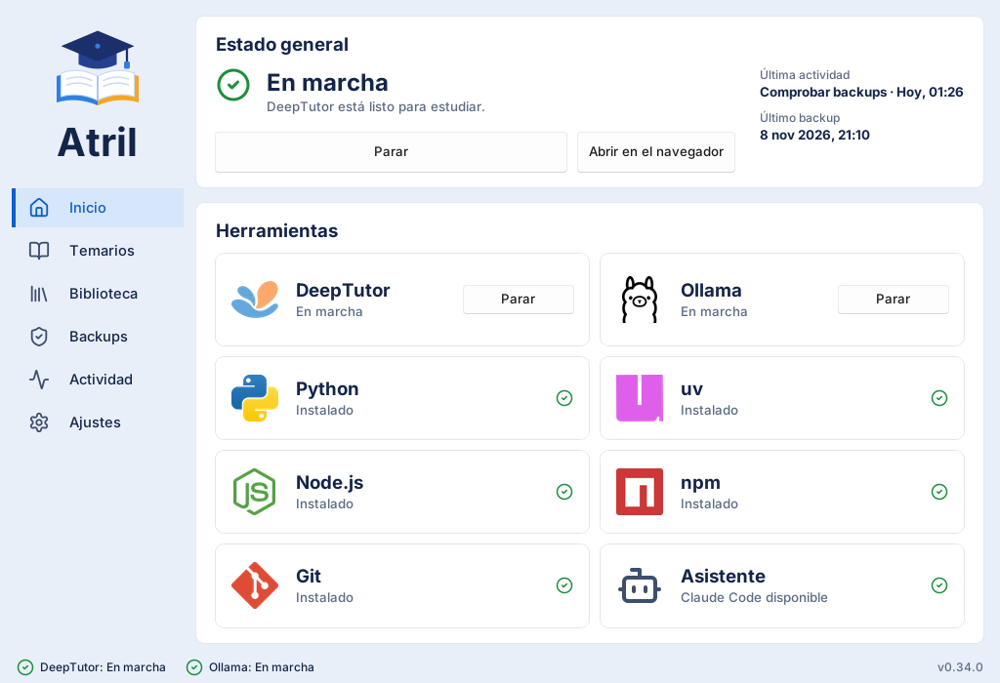

# Instalación

Instalar atril lleva un par de minutos. Después, atril instala DeepTutor por ti.

## Qué necesitas

| Necesitas | Por qué |
|---|---|
| Windows 10 u 11 de 64 bits | Atril está pensado para Windows. En Linux y macOS funciona la consola (ver [abajo](#otros-sistemas)). |
| Conexión a internet | Para descargar atril, Python y, después, DeepTutor. |
| Varios GB libres | DeepTutor y sus dependencias ocupan bastante; el lector de PDF avanzado (Docling) es una descarga grande. |
| Una tarjeta gráfica, mejor | Solo si quieres indexar tus PDF con Ollama en tu ordenador. Sin ella también funciona, más despacio. |

No hace falta ser administrador ni saber usar la consola.

## Instalar atril

1. Descarga **`atril-X.Y.Z-setup.exe`** de la
   [última versión](https://github.com/isidro-rodriguez/atril/releases/latest) (busca el
   fichero que termina en `-setup.exe`).
2. Ábrelo. Windows puede avisar de que el editor es desconocido: pulsa **Más información** y
   después **Ejecutar de todas formas**. Pasa porque el instalador aún no está firmado.
3. Sigue el asistente. Si quieres, marca **Crear un acceso directo en el escritorio**.
4. Al final, el instalador descarga atril y su propio Python (unos 50 MB). Espera a que
   termine y pulsa **Abrir Atril**.

!!! tip "Sin preguntas raras"
    Atril se instala solo para tu usuario, en `%LOCALAPPDATA%\Programs\Atril`, y no toca
    nada más de tu ordenador.

## La primera vez que lo abres

Atril te pide una carpeta para tu **estación de estudio**: ahí guardará DeepTutor, tus
temarios, tus chats y sus índices.

- Si es tu primera vez, elige o crea una **carpeta vacía** con espacio de sobra, por ejemplo
  `D:\Estudio`. Atril la prepara.
- Si ya tenías una estación (una carpeta con `atril.toml`), elige esa carpeta.

Atril recuerda la carpeta: no te la volverá a pedir.

## Instalar DeepTutor

En **Inicio** verás las herramientas que hacen falta. Cada una dice si está instalada y, si
no, ofrece un botón para instalarla.

| Herramienta | ¿Obligatoria? | Para qué |
|---|---|---|
| Git | Sí | Descargar DeepTutor. |
| Node.js y npm | Sí | La parte web de DeepTutor. |
| Python y uv | Sí | El motor de DeepTutor (atril los trae). |
| Ollama | No | Indexar tus PDF en tu ordenador. |
| Asistente | Recomendado | El modelo con el que chateas (por ejemplo, Claude Code o un modelo de Ollama). |

Cuando todo esté en verde, pulsa **Instalar DeepTutor**. La primera vez tarda bastante: deja
la ventana abierta y ve haciendo otra cosa. El progreso se ve en el pie de la ventana.

{ .at-shot }

## Actualizar

No tienes que hacer nada: al abrirse, atril busca una versión nueva y te pregunta si quieres
instalarla. Se cierra, se actualiza y vuelve a abrirse solo. Si DeepTutor está en marcha,
sigue funcionando mientras tanto.

## Desinstalar

Desde **Configuración de Windows > Aplicaciones > Atril > Desinstalar**. Se borra el
programa, pero **nunca tu estación**: tus temarios, chats y copias siguen donde estaban.

## Otros sistemas

En Linux y macOS no hay instalador, pero la consola funciona igual. Con
[uv](https://docs.astral.sh/uv/):

```bash
uv tool install atril     # instalar (actualizar: uv tool upgrade atril)
atril gui                 # abrir la ventana
```

Los detalles están en [Línea de comandos](../documentacion/cli.md).
