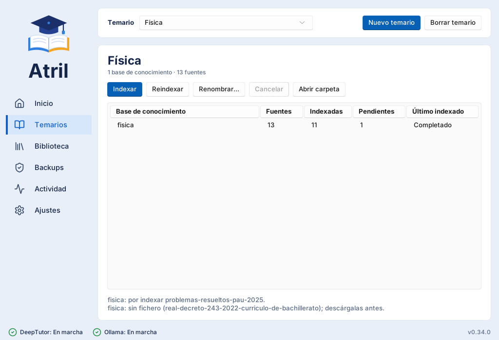
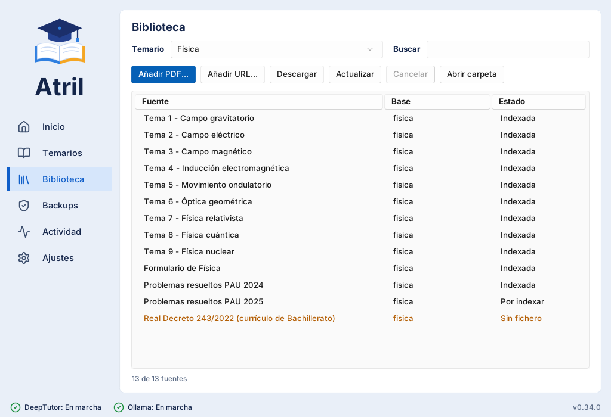

# Primeros pasos

Con atril instalado y DeepTutor listo, estos son los pasos para estudiar tu primera
asignatura.

## 1. Crea un temario

Un **temario** es una asignatura, una oposición o un tema que quieras estudiar. Ve a
**Temarios** y pulsa **Nuevo temario**. Ponle un nombre, por ejemplo «Física 2.º
Bachillerato».

{ .at-shot }

## 2. Añade tus apuntes

Ve a **Biblioteca**, que muestra las fuentes del temario elegido:

- **Añadir PDF…** copia PDF de tu ordenador al temario.
- **Añadir URL…** apunta a un PDF de internet (por ejemplo, una norma en el BOE).
  **Descargar** lo trae.
- **Actualizar** comprueba si los PDF de internet tienen versión nueva. La anterior no se
  pierde: queda en el histórico.

{ .at-shot }

## 3. Indexa

Para que el tutor pueda «leer» tus PDF, hay que **indexarlos**: se trocean y se convierten en
algo que la IA sabe buscar. Vuelve a **Temarios** y pulsa **Indexar**.

!!! info "Hace falta Ollama"
    El indexado usa Ollama, en tu ordenador. Si no lo tienes, instálalo desde **Inicio** y
    actívalo en **Ajustes > Atril > Indexado**.

Puede tardar: un PDF largo, varios minutos. Si cierras la ventana a mitad o pulsas
**Cancelar**, no pasa nada: la próxima vez continúa por donde iba.

## 4. Arranca y estudia

En **Inicio**, pulsa **Arrancar**. Cuando DeepTutor esté listo, se abre en tu navegador.

En el chat, activa tu temario con el icono de la **base de datos** para que el tutor responda
con tus apuntes. Prueba con algo como:

> Explícame la ley de Snell con un ejemplo y dime en qué página del tema 2 aparece.

!!! tip "Cerrar sin parar"
    Si cierras la ventana de atril con DeepTutor en marcha, atril se queda en el **área de
    notificación** (junto al reloj) y DeepTutor sigue funcionando. Desde su icono puedes
    volver a la ventana o salir del todo.

## 5. Haz una copia

Tus temarios y chats valen mucho. En **Backups**, pulsa **Hacer backup**. La primera vez,
indica en **Ajustes > Atril > Backups** dónde guardar las copias: un disco externo o la carpeta
de Google Drive de tu ordenador.

Ya está. Si algo no va como esperas, mira [Preguntas frecuentes](preguntas.md).
