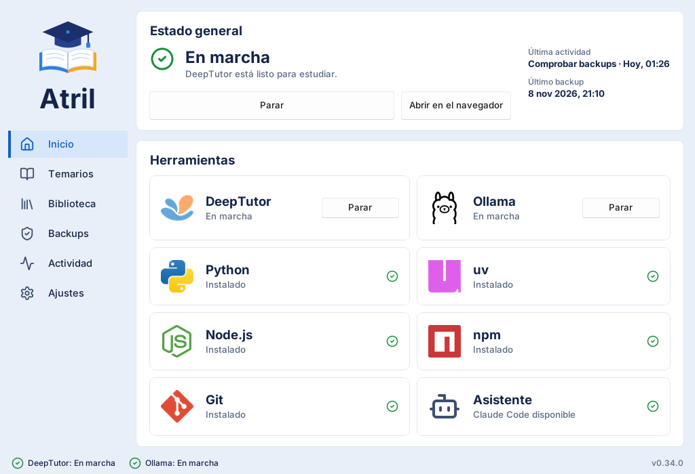
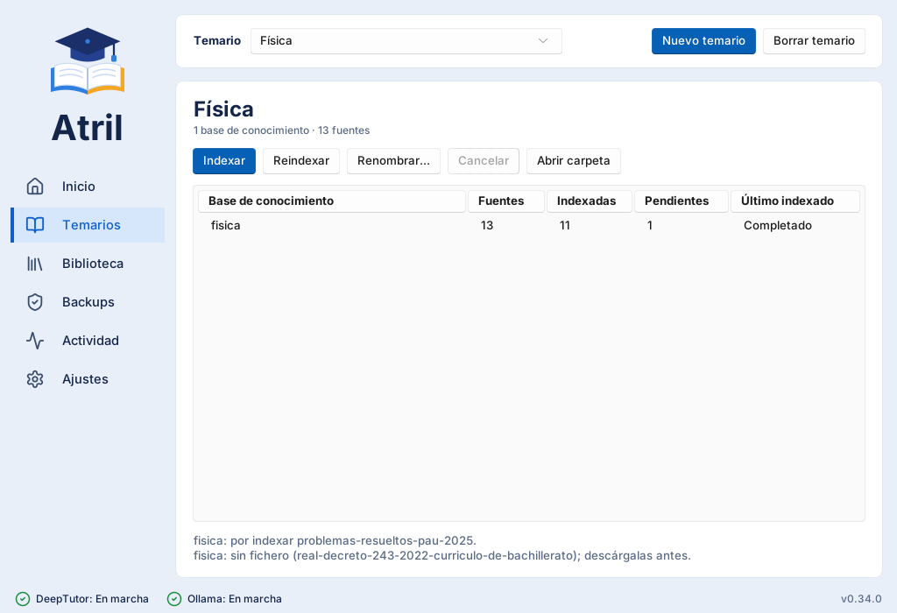
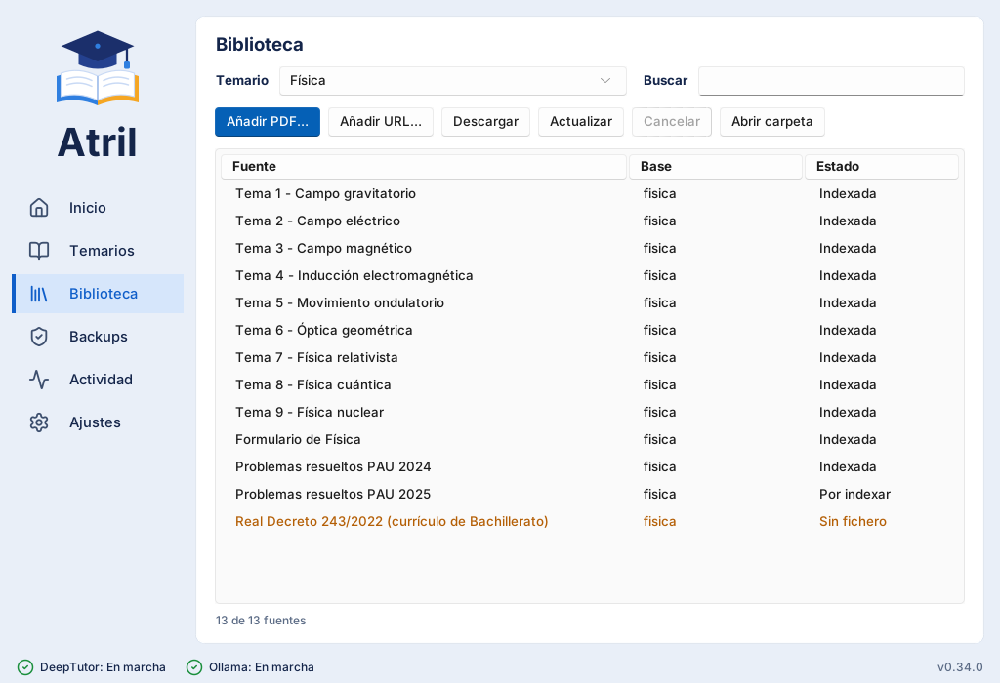
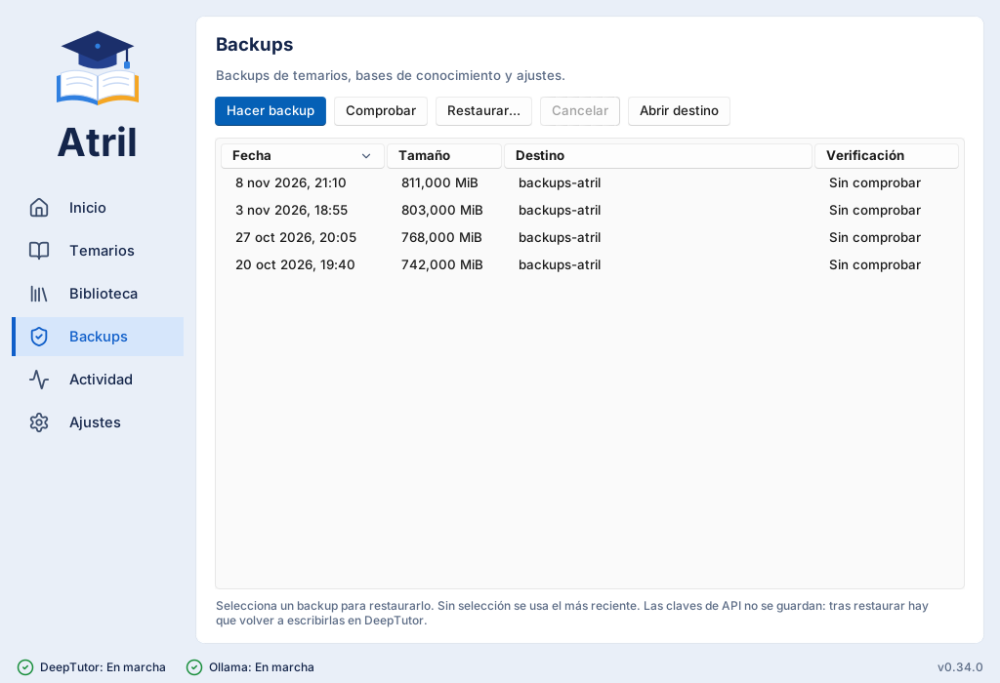
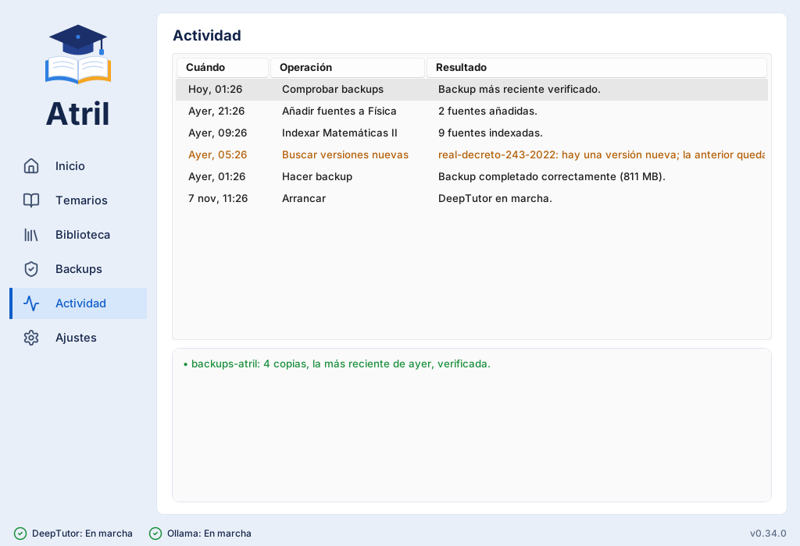
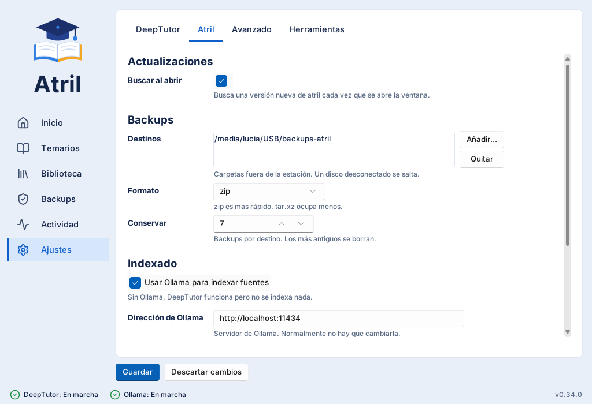

# La ventana

La ventana de atril tiene seis apartados a la izquierda y, abajo, el estado de DeepTutor y
Ollama, la operación en curso y la versión. Al pie de la barra lateral, tres iconos abren
esta web, el repositorio en GitHub y la página en PyPI.

## Inicio

**Estado general** ocupa la mayor parte. Arriba, un icono y una palabra grande con una
frase corta, y a la derecha el botón que resuelve ese estado:

| Estado | Frase | Botón |
|---|---|---|
| En marcha | DeepTutor está listo para estudiar. | Abrir en el navegador y Parar DeepTutor |
| Parado | Inicia DeepTutor para estudiar. | Arrancar DeepTutor |
| Con avisos | Parche pendiente. | Aplicar parche (lo aplica sin arrancar) |
| Con avisos | Parche no encaja con DeepTutor. | Revisar en Ajustes |
| Atención | Falta herramienta por instalar. | Arrancar, desactivado hasta instalarla |
| Atención | Instala DeepTutor para empezar. | Instalar DeepTutor |

Abajo, tres datos que llevan a su apartado al pulsarlos: los **temarios** (cuántos y cuál está
activo), las **fuentes** (cuántas y si falta indexar o descargar alguna) y el **último backup**
(cuándo y si está verificado; se avisa si tiene más de una semana).

Debajo, cada herramienta con su estado y, si hace falta, un botón para instalarla o
arrancarla. Pulsar un logotipo abre la web de esa herramienta.

{ .at-shot }

## Temarios

El temario elegido arriba es el mismo en Temarios y en Biblioteca. Aquí ves sus **bases de
conocimiento** (KB) con sus fuentes, cuántas están indexadas, cuántas están **por indexar**
(nuevas o cambiadas: se resuelven indexando o reindexando) y cuántas están **sin fichero**
(declaradas pero no descargadas: hay que descargarlas antes). Debajo, el detalle de cada
pendiente.

| Botón | Qué hace |
|---|---|
| Nuevo temario | Crea un temario vacío con una KB para todas sus fuentes. |
| Indexar | Añade a la KB las fuentes nuevas, una a una. Se puede cancelar y continuar después. |
| Reindexar | Sustituye las fuentes que han cambiado y quita las retiradas. |
| Renombrar… | Cambia el nombre visible (la carpeta no cambia). |
| Abrir carpeta | Abre la carpeta del temario. |
| Borrar temario | Lo borra para siempre, tras dos confirmaciones (la segunda pide escribir su nombre). |

{ .at-shot }

## Biblioteca

Las fuentes (PDF) del temario, con su KB y su estado. Se puede buscar y ordenar pulsando la
cabecera de cada columna.

{ .at-shot }

## Backups

Las copias de cada destino, con su fecha, tamaño y verificación: **Verificada** (con la
fecha de la última comprobación), **Con errores** o **Sin comprobar**. La verificación se
recuerda al cerrar la ventana y deja de valer si la copia cambia.

| Botón | Qué hace |
|---|---|
| Hacer backup | Comprime la estación (sin el programa de DeepTutor, que se reinstala) en cada destino y borra las más antiguas. |
| Comprobar | Lee la copia más reciente de cada destino para asegurar que está entera. |
| Restaurar… | Vuelve a una copia. Lo que había se conserva aparte, por si acaso. |
| Abrir destino | Abre la carpeta de las copias. |

{ .at-shot }

!!! warning "Las claves no viajan en las copias"
    Si tu asistente usa una clave (de una API en la nube), la copia la guarda vacía. Tras
    restaurar, vuelve a escribirla en DeepTutor.

## Actividad

Todo lo que ha hecho la ventana, con su resultado. Al elegir una operación, abajo aparece el
resultado completo (aunque en la tabla no quepa) y su detalle técnico. Si algo falla, aquí
está la explicación.

Si la actividad no se puede guardar (disco lleno, carpeta sin permisos), el pie de la ventana
lo avisa y el error queda en `atril-diagnostico.log`, en la carpeta temporal de Windows.

{ .at-shot }

## Ajustes

Todo lo que se puede configurar, en pestañas:

| Pestaña | Contenido |
|---|---|
| DeepTutor | El asistente (proveedor y modelo) y el buscador web. |
| Atril | Actualizaciones, destinos de las copias y, al final, Ollama y el ritmo del indexado. |
| Avanzado | Lo que obliga a reinstalar DeepTutor o a reindexar: repositorio, rama, Python, paquetes, parches, puertos y parámetros del indexado. |
| Herramientas | Instalar o reparar, actualizar DeepTutor, aplicar ajustes, diagnóstico, validar la configuración, copiar un informe para pedir ayuda y volver a una versión anterior de DeepTutor. |

{ .at-shot }

Al guardar, atril comprueba el fichero entero y te dice qué hace falta para que el cambio
surta efecto (aplicarlo, reinstalar o reindexar).

## Área de notificación

Si cierras la ventana con DeepTutor en marcha, atril se queda junto al reloj de Windows. Con
el botón derecho sobre su icono:

| Opción | Qué hace |
|---|---|
| Mostrar atril | Vuelve a la ventana (también con un clic en el icono). |
| Abrir DeepTutor | Lo abre en el navegador. |
| Arrancar o parar DeepTutor | Según su estado. |
| Hacer backup | Hace una copia sin abrir la ventana. |
| Ver actividad | Abre la ventana en Actividad. |
| Salir | Para DeepTutor y el Ollama que abrió atril, y cierra atril. |

Con la ventana oculta, atril te avisa con notificaciones de Windows al terminar cada operación
o si DeepTutor se para.
