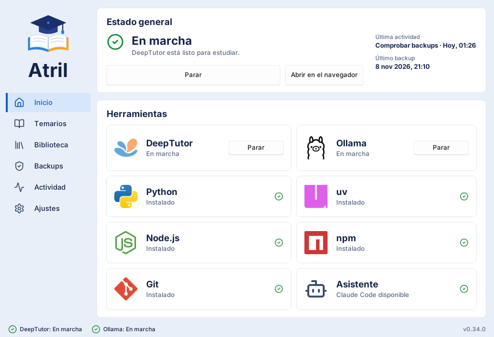

# Atril

Tu tutor con inteligencia artificial para estudiar <strong>tus propios apuntes</strong>,
en tu ordenador. Atril instala y cuida <a href="https://github.com/HKUDS/DeepTutor">DeepTutor</a>
por ti: tú añades tus PDF y empiezas a preguntar.

[:fontawesome-brands-windows: Descargar para Windows](https://github.com/isidro-rodriguez/atril/releases/latest){ .md-button .md-button--primary }
[Primeros pasos](guia/primeros-pasos.md){ .md-button }

Gratis y de código abierto. Windows 10 u 11, sin permisos de administrador.

## ¿Qué es atril?

Un **atril** es donde apoyas el libro para estudiar. Este atril sostiene a DeepTutor, un tutor
con IA que lee tus temarios y te responde citando la página exacta. DeepTutor es muy potente,
pero instalarlo y mantenerlo exige consola, Python, Node.js y bastante paciencia. Atril se
encarga de todo eso con botones.

:material-book-open-page-variant:
### Estudia con tus apuntes
Sube los PDF de cada asignatura y pregunta lo que no entiendas. Las respuestas salen de tu
temario, no de internet.

:material-laptop:
### Todo en tu ordenador
Tus temarios, tus chats y tus índices se quedan en una carpeta tuya. Haz copias de seguridad
con un clic.

:material-gesture-tap-button:
### Sin pelearte con la consola
Instalar, arrancar, actualizar e indexar se hace desde una ventana sencilla. La consola sigue
ahí si te gusta.

:material-update:
### Se cuida solo
Avisa cuando hay una versión nueva y se actualiza. Si algo falla, te dice qué pasa y cómo
arreglarlo.

## Cómo funciona

<ol class="at-steps" markdown>
<li markdown>**Instala atril** con el instalador de Windows. Es una descarga pequeña.</li>
<li markdown>**Elige una carpeta** para tu estación de estudio. Ahí vivirá todo.</li>
<li markdown>**Instala DeepTutor** con un botón. La primera vez tarda un rato: descarga varios GB.</li>
<li markdown>**Crea un temario**, añade tus PDF y pulsa **Indexar**.</li>
<li markdown>**Pulsa Arrancar** y estudia en el navegador con tu tutor.</li>
</ol>

[Ver la guía paso a paso](guia/instalacion.md){ .md-button .md-button--primary }

## ¿Qué hay en esta web?

| Sección | Para quién | Qué encontrarás |
|---|---|---|
| [Guía](guia/instalacion.md) | Todo el mundo | Instalar, primeros pasos, la ventana apartado a apartado y preguntas frecuentes. |
| [Documentación](documentacion/conceptos.md) | Quien quiere ir más allá | Conceptos, línea de comandos, `atril.toml` y `temario.toml` con ejemplos, indexado, copias y actualizaciones. |
| [Desarrollo](desarrollo/contribuir.md) | Quien quiere colaborar | Entorno, calidad, pruebas y publicación. |

El código, las versiones publicadas y el historial de cambios están en
[GitHub](https://github.com/isidro-rodriguez/atril). Atril también está en
[PyPI](https://pypi.org/project/atril/).
